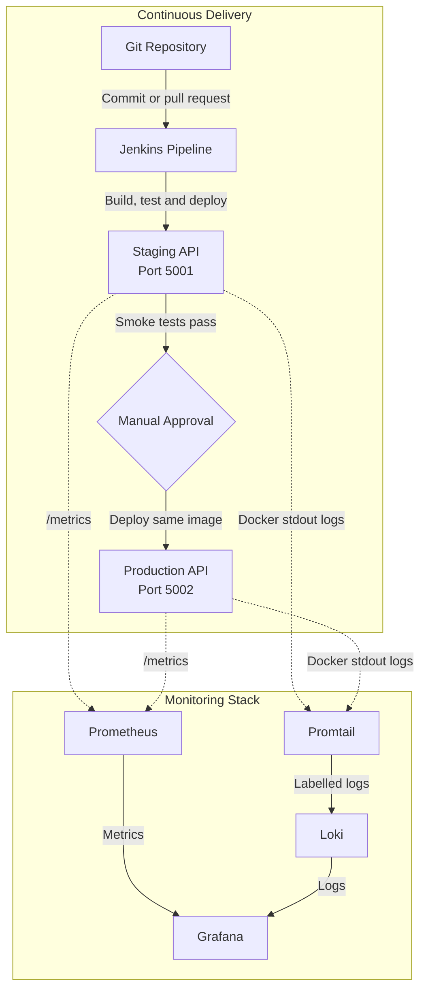

# System Health Dashboard

A small Flask API that exposes application health, version, and environment information. The project demonstrates a Git-to-deployment workflow using automated tests, Docker, and Jenkins.

## Features

- Flask REST API
- Environment-based configuration
- Automated endpoint tests with pytest
- Docker image and container support
- Jenkins pipeline for checkout, dependency installation, testing, image build, tagging, and health checking

## API endpoints

| Method | Endpoint | Purpose | Example response |
| --- | --- | --- | --- |
| `GET` | `/health` | Confirms that the application is running | `{"status":"UP"}` |
| `GET` | `/version` | Returns the application version | `{"version":"1.0.1"}` |
| `GET` | `/environment` | Returns the configured environment | `{"environment":"development"}` |
| `POST` | `/echo` | Returns a submitted JSON payload | `{"echo":{"message":"Hello"}}` |

The three required dashboard endpoints are `/health`, `/version`, and `/environment`. The `/echo` endpoint is an additional example of a `POST` endpoint.

## Prerequisites

- Git
- Python 3.13 or compatible Python 3
- Docker Desktop
- Java and Jenkins for the CI pipeline

## Run locally

From the repository root, create a virtual environment and install the dependencies:

~~~powershell
py -m venv .venv
.\.venv\Scripts\Activate.ps1
python -m pip install -r requirements.txt
~~~

Set the environment name and start the application:

~~~powershell
$env:ENVIRONMENT = "development"
py app.py
~~~

The API runs on port `5000`.

## Run the tests

Run the complete test suite with one command:

~~~powershell
py -m pytest -q
~~~

The tests cover the health, version, echo, and environment endpoints.

## Verify the local API

With the application running, use a browser or PowerShell:

~~~powershell
Invoke-RestMethod http://localhost:5000/health
Invoke-RestMethod http://localhost:5000/version
Invoke-RestMethod http://localhost:5000/environment
~~~

Expected responses include:

~~~json
{"status":"UP"}
{"version":"1.0.1"}
{"environment":"development"}
~~~

## Build and run with Docker

Build a versioned image:

~~~powershell
docker build -t system-health-dashboard:1.0.1 .
~~~

Run the container with an externalised environment value:

~~~powershell
docker run -d --name system-health-dashboard -p 5000:5000 -e ENVIRONMENT=production system-health-dashboard:1.0.1
~~~

Verify the endpoints from the running container:

~~~powershell
Invoke-RestMethod http://localhost:5000/health
Invoke-RestMethod http://localhost:5000/version
Invoke-RestMethod http://localhost:5000/environment
~~~

The environment response should show `production` because it was supplied when the container was started.

To stop and remove the container:

~~~powershell
docker rm -f system-health-dashboard
~~~

Docker Compose can also be used:

~~~powershell
docker compose up --build
~~~

The Compose configuration publishes the application on `http://localhost:5000`.

## Jenkins pipeline

The `Jenkinsfile` defines a Windows Jenkins pipeline with these stages:

| Stage | Action |
| --- | --- |
| Checkout | Retrieves the configured repository and `develop` branch |
| Install | Creates a virtual environment and installs `requirements.txt` |
| Test | Runs the complete pytest suite |
| Build | Builds a Docker image tagged with the Jenkins build number |
| Tag | Creates a shorter build-number image tag |
| Health check | Starts the image and verifies `/health` on port `5001` |

The Docker images created by Jenkins use these tags:

~~~text
system-health-dashboard:build-<BUILD_NUMBER>
system-health-dashboard:<BUILD_NUMBER>
~~~

The Jenkins health-check container uses:

~~~text
http://localhost:5001/health
~~~

The pipeline removes the temporary Jenkins container after every run.

## Mini Project 2 plan

The second project extends this application with Continuous Delivery and monitoring. The planned work is:

- [ ] Add Prometheus metrics, structured JSON logging, and guarded fault injection.
- [ ] Build the Prometheus, Grafana, Loki, and Promtail monitoring stack.
- [ ] Create a provisioned Grafana dashboard for metrics and logs.
- [ ] Define service-down and high-error-rate alert rules.
- [ ] Extend Jenkins to deploy to staging, require production approval, run smoke tests, and roll back on failure.
- [ ] Complete an incident drill and record the evidence in `INCIDENT.md`.
- [ ] Complete the README, screenshots, and individual reflection.

### Mini Project 2 architecture

Prometheus collects application metrics, Promtail collects Docker logs, Loki stores those logs, and Grafana displays the metrics and logs.

### Jenkins job setup

1. Create a Jenkins Pipeline job.
2. Select **Pipeline script from SCM**.
3. Select **Git** and enter the repository URL.
4. Select the required GitHub credential if the repository requires authentication.
5. Set the branch specifier to `*/develop`.
6. Set the script path to `Jenkinsfile`.
7. Run **Build Now** and review the console output.

The Jenkins service must be able to access Git, Python, Docker Desktop, and Docker Buildx. On the Windows setup used for this project, the Jenkins service also needs the Docker configuration path:

~~~text
DOCKER_CONFIG=C:\Users\Fahad\.docker
~~~

The current Jenkinsfile uses this Python executable path:

~~~text
C:\Users\Fahad\AppData\Local\Programs\Python\Python313\python.exe
~~~

If Python is installed in a different location, update the path in the Jenkinsfile.

## Git workflow

The project uses `main` as the final branch and `develop` as the integration branch. Work is completed on feature branches, then reviewed and merged through pull requests.

Example workflow:

~~~powershell
git switch develop
git pull origin develop
git switch -c feature/my-change

git add .
git commit -m "Describe the change"
git push -u origin feature/my-change
~~~

Open a pull request from the feature branch into `develop`. After integration and review, open the final pull request from `develop` into `main`.

