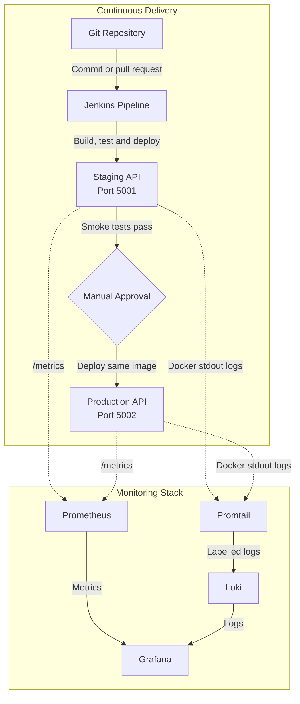

# System Health Dashboard

A small Flask API that exposes application health, version, and environment information. The project demonstrates a Git-to-deployment workflow using automated tests, Docker, and Jenkins.

## Features

- Flask REST API
- Environment-based configuration
- Automated endpoint tests with pytest
- Docker image and container support
- Jenkins pipeline for checkout, dependency installation, testing, image build, tagging, and health checking

## API endpoints

| Method | Endpoint | Purpose | Example response |
| --- | --- | --- | --- |
| `GET` | `/health` | Confirms that the application is running | `{"status":"UP"}` |
| `GET` | `/version` | Returns the application version | `{"version":"1.0.1"}` |
| `GET` | `/environment` | Returns the configured environment | `{"environment":"development"}` |
| `GET` | `/metrics` | Returns Prometheus metrics | Prometheus text format |
| `GET` | `/simulate-error` | Generates a controlled HTTP 500 when enabled | `{"error":"Simulated fault"}` |

## Prerequisites

- Git
- Python 3.13 or compatible Python 3
- Docker Desktop
- Java and Jenkins for the CI pipeline

## Run locally

From the repository root, create a virtual environment and install the dependencies:

~~~powershell
py -m venv .venv
.\.venv\Scripts\Activate.ps1
python -m pip install -r requirements.txt
~~~

Set the environment name and start the application:

~~~powershell
$env:ENVIRONMENT = "development"
py app.py
~~~

The API runs on port `5000`.

## Run the tests

Run the complete test suite with one command:

~~~powershell
py -m pytest -q
~~~

Jenkins also writes the results to `reports/junit.xml` and publishes them through
the Jenkins JUnit test-results view.

The tests cover the health, version, environment, metrics, and fault-injection endpoints.

## Verify the local API

With the application running, use a browser or PowerShell:

~~~powershell
Invoke-RestMethod http://localhost:5000/health
Invoke-RestMethod http://localhost:5000/version
Invoke-RestMethod http://localhost:5000/environment
~~~

Expected responses include:

~~~json
{"status":"UP"}
{"version":"1.0.1"}
{"environment":"development"}
~~~

## Build and run with Docker

Build a versioned image:

~~~powershell
docker build -t system-health-dashboard:1.0.1 .
~~~

Run the container with an externalised environment value:

~~~powershell
docker run -d --name system-health-dashboard -p 5000:5000 -e ENVIRONMENT=production system-health-dashboard:1.0.1
~~~

Verify the endpoints from the running container:

~~~powershell
Invoke-RestMethod http://localhost:5000/health
Invoke-RestMethod http://localhost:5000/version
Invoke-RestMethod http://localhost:5000/environment
~~~

The environment response should show `production` because it was supplied when the container was started.

To stop and remove the container:

~~~powershell
docker rm -f system-health-dashboard
~~~

Docker Compose can also be used:

~~~powershell
docker compose up --build
~~~

The Compose configuration publishes the application on `http://localhost:5000`.

## Jenkins pipeline

The `Jenkinsfile` defines a Windows Jenkins pipeline with these stages:

| Stage | Action |
| --- | --- |
| Checkout | Retrieves the configured repository and `develop` branch |
| Install | Creates a virtual environment and installs `requirements.txt` |
| Test | Runs the complete pytest suite |
| Build | Builds a Docker image tagged with the Jenkins build number |
| Tag | Creates the immutable release image tag used by both environments |
| Local health check | Starts the release image and verifies `/health` on port `5001` |
| Prepare deployment network | Ensures the shared Docker network exists on the Jenkins agent |
| Deploy staging | Deploys the release image with the staging Compose file |
| Staging smoke tests | Verifies `/health`, `/version`, and `/metrics` on port `5001` |
| Verify monitoring | Confirms the staging Prometheus target is UP |
| Production approval | Pauses for manual approval before production deployment |
| Deploy production | Deploys the exact same release image with the production Compose file |
| Production smoke tests | Verifies `/health`, `/version`, and `/metrics` on port `5002` |
| Verify production monitoring | Confirms the production Prometheus target is UP |
| Rollback on failure | Restores the previous staging or production image tag |

This pipeline implements Continuous Delivery: Jenkins automatically builds, tests,
and deploys a release to staging, but a person must approve the production
deployment. Continuous Deployment would remove that approval and deploy every
validated change to production automatically. The single change needed to move
to Continuous Deployment is removing the Jenkins `input` approval step after
the staging checks.

The Docker images created by Jenkins use these tags:

~~~text
system-health-dashboard:build-<BUILD_NUMBER>
system-health-dashboard:release-<BUILD_NUMBER>
system-health-dashboard:staging-current
system-health-dashboard:production-current
~~~

The Jenkins health-check container uses:

~~~text
http://localhost:5003/health
~~~

The pipeline removes the temporary Jenkins container after every run.

### Roll back a deployment

Jenkins records the currently deployed image as `staging-current` or
`production-current` before replacing it, and preserves that image as the
corresponding `*-previous` tag. If a deployment or smoke test fails, the
Jenkins `post { failure { ... } }` block automatically runs the rollback script
for each environment that was deployed.

The Jenkins rollback sequence is: build and test the new release, save the
currently deployed tag as `*-previous`, deploy the new release, and run the
smoke test. If deployment or a smoke test fails, Jenkins calls
`scripts/rollback.sh` with the affected environment. The script checks that the
previous image exists, starts it with the environment's Compose file using
`APP_IMAGE`, recreates the container without rebuilding, and updates the
`*-current` tag to the restored image. A rollback failure is reported as a
Jenkins failure so the console output can be investigated.

To perform a manual rollback from Git Bash, run the command for the affected
environment from the repository root:

~~~bash
IMAGE_NAME=system-health-dashboard bash scripts/rollback.sh staging
IMAGE_NAME=system-health-dashboard bash scripts/rollback.sh production
~~~

The script restores the previous image, recreates the Compose service, and
updates the current image tag. Verify the recovery with the environment's
`/health`, `/version`, and `/metrics` endpoints and then confirm the target is
UP in Prometheus.

## Mini Project 2 plan

The second project extends this application with Continuous Delivery and monitoring. The planned work is:

- [x] Add Prometheus metrics, structured JSON logging, and guarded fault injection.
- [x] Build the Prometheus, Grafana, Loki, and Promtail monitoring stack.
- [x] Create a provisioned Grafana dashboard for metrics and logs.
- [x] Define service-down and high-error-rate alert rules.
- [x] Extend Jenkins to deploy to staging, require production approval, run smoke tests, and roll back on failure.
- [x] Complete an incident drill and record the evidence in `INCIDENT.md`.
- [x] Complete the README and individual reflection.
- [ ] Add and label the required submission screenshots.

### Mini Project 2 architecture

Prometheus collects application metrics, Promtail collects Docker logs, Loki stores those logs, and Grafana displays the metrics and logs.

## Start the monitoring stack

Task 3 uses Docker Compose to run staging, production, Prometheus, Grafana, Loki, and Promtail on the shared `system-health-network` network. Docker Desktop must be running first.

Copy the example environment file and set a private Grafana password:

~~~powershell
Copy-Item .env.example .env
notepad .env
~~~

Start the monitoring services first. This creates the shared Docker network:

~~~powershell
docker compose --env-file .env -f monitoring/docker-compose.monitoring.yml up -d
~~~

Start the two application environments:

~~~powershell
docker compose -f docker-compose.staging.yml up -d --build
docker compose -f docker-compose.production.yml up -d --build
~~~

Verify the applications and metrics endpoints:

~~~powershell
Invoke-RestMethod http://localhost:5001/health
Invoke-RestMethod http://localhost:5001/metrics
Invoke-RestMethod http://localhost:5002/health
Invoke-RestMethod http://localhost:5002/metrics
~~~

Then open:

- Prometheus targets: `http://localhost:9090/targets`
- Grafana: `http://localhost:3000`
- Loki: `http://localhost:3100/ready`

Prometheus should show `app-staging:5000` and `app-production:5000` as `UP`. Grafana's Prometheus and Loki data sources are provisioned automatically from files in `monitoring/grafana/provisioning`.

The staff-provided Jenkins, Grafana, and Prometheus URLs are shared lab services. They are not hard-coded into this repository because the project configuration must be reproducible and uses Docker service names. Use those shared URLs for hosted deployment and evidence after Jenkins deploys this project or your facilitator adds these application targets to the shared Prometheus instance.

### Jenkins job setup

1. Create a Jenkins Multibranch Pipeline job, or create separate Pipeline jobs for `develop` and `main`.
2. Select **Pipeline script from SCM**.
3. Select **Git** and enter the repository URL.
4. Select the required GitHub credential if the repository requires authentication.
5. Configure branch discovery so Jenkins builds both `develop` and `main`.
6. Set the script path to `Jenkinsfile`.
7. Run a `develop` build to demonstrate automatic staging delivery, then run a `main` build to demonstrate the production approval gate.

The Jenkins service must be able to access Git, Python, Docker Desktop, and Docker Buildx. On the Windows setup used for this project, the Jenkins service also needs the Docker configuration path:

~~~text
DOCKER_CONFIG=C:\Users\Fahad\.docker
~~~

The current Jenkinsfile uses this Python executable path:

~~~text
C:\Users\Fahad\AppData\Local\Programs\Python\Python313\python.exe
~~~

If Python is installed in a different location, update the path in the Jenkinsfile.

## Git workflow

The project uses `main` as the final branch and `develop` as the integration branch. Work is completed on feature branches, then reviewed and merged through pull requests.

Example workflow:

~~~powershell
git switch develop
git pull origin develop
git switch -c feature/my-change

git add .
git commit -m "Describe the change"
git push -u origin feature/my-change
~~~

Open a pull request from the feature branch into `develop`. After integration and review, open the final pull request from `develop` into `main`.

## AI assistance disclosure

I used approved AI assistance to help plan, understand, develop, and troubleshoot
parts of the Jenkins pipeline, Dockerfile, monitoring configuration, tests, and
documentation. I reviewed the suggestions, tested the implementation, and
verified that I understand every submitted file and command.

